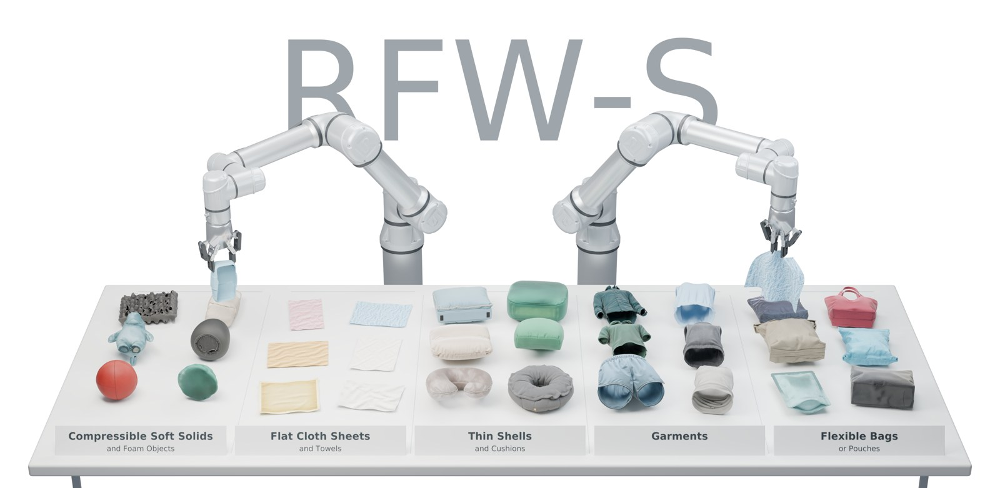

<div align="center">

# RFW-S: Everyday Deformable Objects with Independent Simulation Verification

Jiarui Guo<sup>1,2,\*</sup>, Saining Zhang<sup>2,3,\*,†</sup>, Jiaying Wan<sup>2</sup>, Jiawei Weng<sup>1</sup>, Junhao Chen<sup>2</sup>, Rui Zhang<sup>1,2</sup>, Yuanbo Lyu<sup>1</sup>, Zhiheng Lee<sup>2</sup>, Peishuo Li<sup>3</sup>, Jingrun Du<sup>1,2</sup>, Weiqing Xiao<sup>4</sup>, Weiyi Lin<sup>1</sup>, Zenan Meng<sup>1,‡</sup>, Hu Wei<sup>1,‡</sup>, Lin Qu<sup>1</sup>, Zongzheng Zhang<sup>2</sup>, Hao Zhao<sup>2</sup>, Chaojian Li<sup>5,‡</sup>

<sup>1</sup>Alibaba Group &nbsp; <sup>2</sup>Tsinghua University &nbsp; <sup>3</sup>Nanyang Technological University &nbsp; <sup>4</sup>Nanjing University &nbsp; <sup>5</sup>The Hong Kong University of Science and Technology

<sub>\*Equal contribution. †Project leader. ‡Corresponding authors.</sub>

</div>

<div align="center">
  <a href="https://arxiv.org/abs/2611.23056"></a>
  <a href="LICENSE"></a>
  <a href="docs/REPRODUCIBILITY.md"></a>
  <a href="README_zh.md"></a>
</div>

<div align="center">
  
</div>

**RobotFlyWheel-Soft (RFW-S)** is a 100,000-asset resource of everyday deformable
objects that connects object coverage, structure-aware geometry, effective
simulator parameters, calibration feedback, and **independent simulation
verification**.

*Teaser: conceptual rendering of the resource scope; quantitative evidence comes from the archived analysis CSVs.*

[中文说明](README_zh.md) · [Installation](docs/INSTALL.md) · [Pipeline walkthrough](docs/PIPELINE.md) · [Data and contracts](docs/DATA.md) · [Reproduce tables](docs/REPRODUCIBILITY.md)

## 📰 News

- **October 2026:** Open-source code release under Apache-2.0 — asset pipeline, calibration agent, formal experiment runner, fixtures, and archived analysis data.

## ✨ Highlights

- **Everyday coverage** — 100,000 assets spanning 485 categories in five structural families
- **Independent verification** — a frozen candidate is evaluated with a separate stimulus; physical and runtime checks are reported independently
- **Calibration feedback** — bounded parameter correction with full revision traces
- **Reproducible claims** — archived analysis CSVs regenerate every manuscript table

## 📊 Resource at a Glance

The current manuscript reports a **100,000-asset pool spanning 485 categories** across five structural families. Physical verification accepts 83,618 assets, runtime checks accept 99,586, and their configuration-matched intersection contains **83,365 assets**. All 485 categories remain represented after both checks.

| Family | Categories | Pool | Physical | Runtime | Both |
| --- | ---: | ---: | ---: | ---: | ---: |
| Soft solids | 168 | 34,641 | 21,112 | 34,502 | 21,103 |
| Cloth sheets | 89 | 18,347 | 18,308 | 18,097 | 18,064 |
| Shells | 63 | 12,990 | 11,415 | 12,990 | 11,415 |
| Garments | 94 | 19,386 | 19,055 | 19,386 | 19,055 |
| Bags | 71 | 14,636 | 13,728 | 14,611 | 13,728 |
| **Total** | **485** | **100,000** | **83,618** | **99,586** | **83,365** |

Source: [`paper/analysis_data/verification_by_family.csv`](paper/analysis_data/verification_by_family.csv) and the generated [dataset table](paper/results/T02_dataset.tex).

## 🔬 Simulation and Evidence Scope

The included reference configurations use **Genesis 1.3.3**, `PBD.Cloth` and `MPM.Elastic` / `MPM.ElastoPlastic`, with `LegacyCoupler`. Parameter values describe effective behavior under the recorded representation, numerics, and probes; they are not measured real-material ground truth. Independent tests evaluate a frozen candidate with a separate stimulus. The fragile-object damage model is a continuum damage/stiffness-loss surrogate. Available coupler force evidence and deformation-based integrity limits are described in the code and [data documentation](docs/DATA.md).

## 🛠️ Quick Start

Python 3.10 or newer is required. The CPU fixture path needs no GPU, API key, or production dataset. Run these commands from the repository root:

```bash
python3 -m venv .venv
source .venv/bin/activate
python -m pip install --upgrade pip setuptools
python -m pip install --no-build-isolation ./code ./asset_pipeline

softsim-exp --help
softsim-assets --help
softsim-physical-agent smoke --output ./runs/physical-smoke
softsim-exp fixture e1 --output ./runs/e1-10 --count 10
softsim-exp fixture e2 --output ./runs/e2-10 --count 10
softsim-exp fixture e3a --output ./runs/e3a-10 --count 10
```

The fixtures exercise contracts and orchestration with synthetic evidence. Their outputs do not reproduce full-scale simulation measurements or establish physical validity.

To run the test suite and regenerate the archived paper tables:

```bash
python -m pip install -r requirements-dev.txt
python -m pytest -q
python paper/build_support/verify_analysis.py
python paper/build_support/build_results.py
```

See [installation](docs/INSTALL.md) for the optional mesh dependencies, GPU runtime, and test skips; follow the [pipeline walkthrough](docs/PIPELINE.md) for asset and physical-prior examples.

## 🗂️ What This Code Release Contains

| Directory | Contents |
| --- | --- |
| `asset_pipeline/` | Asset inventory, GLB audit, procedural cloth, immutable ledgers, physical-prior production |
| `code/src/softsim_physical_agent/` | Calibration, bounded parameter correction, independent probes, revision traces |
| `code/src/softsim_genesis_runner/` | Genesis episode adapter and isolated simulator worker |
| `code/scripts/` | Probe runners, mesh representation tools, release conversion, analysis helpers |
| `code/fragile_soft_benchmark/` | Fragile-object instance construction, qualification and damage-proxy evaluation |
| `code/src/softsim_formal/` | Experiment planning, deterministic sharding, resume, aggregation and rendering |
| `configs/`, `code/contracts/` | Versioned method configurations and JSON contracts |
| `tests/`, `asset_pipeline/tests/` | Local fixtures and regression tests |
| `paper/` | Analysis CSV snapshot and manuscript table generator |

This Git repository contains code, small synthetic fixtures, and analysis data. Full meshes, reference images, trajectories, production physical bundles, model weights, and evaluator-only targets are **not included**. A public full-dataset download URL has not been configured in this snapshot; see [data availability](docs/DATA.md). Cloud-specific job launchers and credentials are excluded.

## 📖 Citation

The associated manuscript is **RFW-S: Everyday Deformable Objects with Independent Simulation Verification** ([arXiv:2611.23056](https://arxiv.org/abs/2611.23056)). See also [CITATION.cff](CITATION.cff).

```bibtex
@article{guo2026rfws,
  title   = {RFW-S: Everyday Deformable Objects with Independent Simulation Verification},
  author  = {Guo, Jiarui and Zhang, Saining and Wan, Jiaying and Weng, Jiawei and Chen, Junhao and Zhang, Rui and Lyu, Yuanbo and Lee, Zhiheng and Li, Peishuo and Du, Jingrun and Xiao, Weiqing and Lin, Weiyi and Meng, Zenan and Wei, Hu and Qu, Lin and Zhang, Zongzheng and Zhao, Hao and Li, Chaojian},
  journal = {arXiv preprint arXiv:2611.23056},
  year    = {2026}
}
```

## 🙏 Acknowledgements

Simulation runs on [Genesis](https://genesis-embodied-ai.github.io/). External models, software, and separately distributed datasets retain their own terms; see [third-party components](docs/THIRD_PARTY.md).

## License

Original source code is licensed under [Apache-2.0](LICENSE). The Apache-2.0 grant covers only this repository's original code: it does **not** extend to third-party model weights (e.g. Qwen, TRELLIS.2), simulation runtimes, or separately distributed datasets, each of which remains under its own license — see [third-party components](docs/THIRD_PARTY.md). Model weights and dataset payloads are not committed to this repository. [Contribution guidelines](CONTRIBUTING.md) describe local checks and release boundaries.
