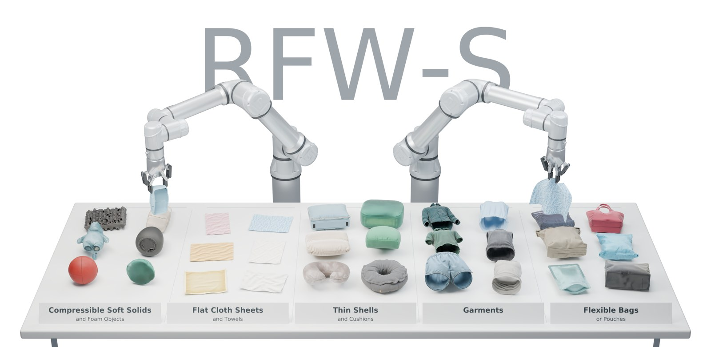

# RFW-S 开源代码

**RFW-S: Everyday Deformable Objects with Independent Simulation Verification**

RFW-S（RobotFlyWheel-Soft）围绕日常可变形物体，将语义类别、结构表示、有效仿真参数、校准反馈和独立验证连接成可追踪的数据生产流程。

[English README](README.md) · [安装](docs/INSTALL.md) · [流程示例](docs/PIPELINE.md) · [数据与契约](docs/DATA.md) · [论文表格复现](docs/REPRODUCIBILITY.md)



## 当前论文统计

候选池包含 **100,000 件资产、485 个类别、5 个结构家族**。物理验证通过 83,618 件，运行检查通过 99,586 件，两者配置匹配的交集为 **83,365 件**；交集中仍覆盖全部 485 类。分家族数字及来源见英文 README 和 `paper/analysis_data/verification_by_family.csv`。

本仓库包含资产盘点、GLB 检查、程序化布料、物理先验、校准与独立探针、Genesis 适配、易碎软体评测、实验编排、测试及论文分析 CSV。完整网格、参考图、生产轨迹、物理包、模型权重和评测端隐藏目标未打包进 Git；当前尚无已确认的完整数据集公开下载地址。

## 本地开始

在仓库根目录执行，Python 3.10+：

```bash
python3 -m venv .venv
source .venv/bin/activate
python -m pip install --upgrade pip setuptools
python -m pip install --no-build-isolation ./code ./asset_pipeline
softsim-physical-agent smoke --output ./runs/physical-smoke
softsim-exp fixture e1 --output ./runs/e1-10 --count 10
softsim-exp fixture e2 --output ./runs/e2-10 --count 10
softsim-exp fixture e3a --output ./runs/e3a-10 --count 10
```

这些 fixture 使用合成证据验证流程，无需 GPU 或 API 密钥，不能作为论文仿真结果。测试和表格复现：

```bash
python -m pip install -r requirements-dev.txt
python -m pytest -q
python paper/build_support/verify_analysis.py
python paper/build_support/build_results.py
```

真实探针另需 Genesis 1.3.3 与相应 GPU 环境；按安装文档配置 `GENESIS_PYTHON`。可选 Qwen proposer 通过环境变量读取 API 密钥。参数表示记录的求解器与行为契约下的有效参数，不是真实材料测量值；损伤模型是连续损伤/刚度衰减代理模型。

原创代码按 [Apache-2.0](LICENSE) 发布。第三方模型、软件与单独发布的数据遵循各自许可。论文标题已对齐当前稿；确认公开 arXiv 编号和完整作者名单后再补齐引用信息。
